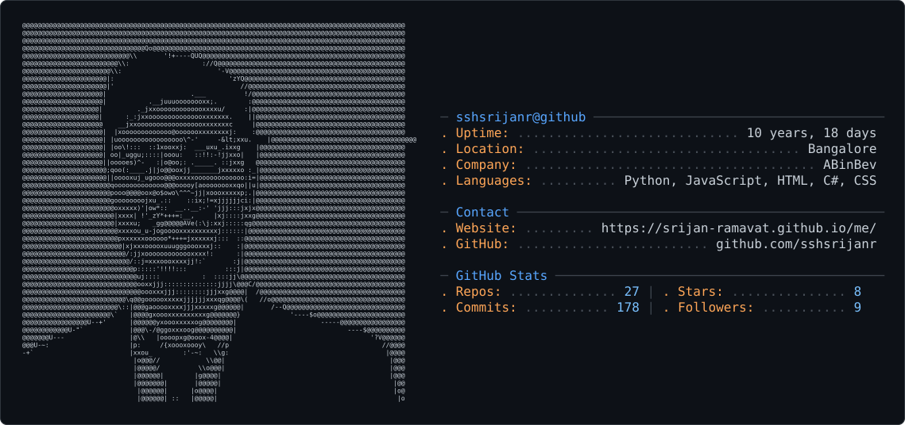

<picture>
  <source media="(prefers-color-scheme: dark)" srcset="dark_mode.svg" />
  <source media="(prefers-color-scheme: light)" srcset="light_mode.svg" />
  
</picture>

📢 Nominate ([@sshsrijanr](https://github.com/sshsrijanr/)) as **[GitHub Star](https://stars.github.com/nominate)**. If you appreciate his hard work and dedication to open source.

---

#  Hello, my name is Srijan.

I am 🧙 Software Engineer

Welcome to my page; on my GitHub, you can find:
- Projects created by me 
- Machine Learning write-ups by me
- Tutorials and Best Practices around programming

#### 📧 You can contact me at:

*I am open to new opportunities.*

#### 🔎 You can find me on: 

--- 
#### I am 🧙 Software Engineer on full-time.

In my view, the best approach is to pick the tech that's just right for the problem.

Additionally, I enjoy expanding my knowledge, and because of that, I am open to learning new technologies and languages 🐱‍👓

#### My current technology stack:

####  I am 👾 Backend Developer and 🔏 AI Agent Developer in my free time.
